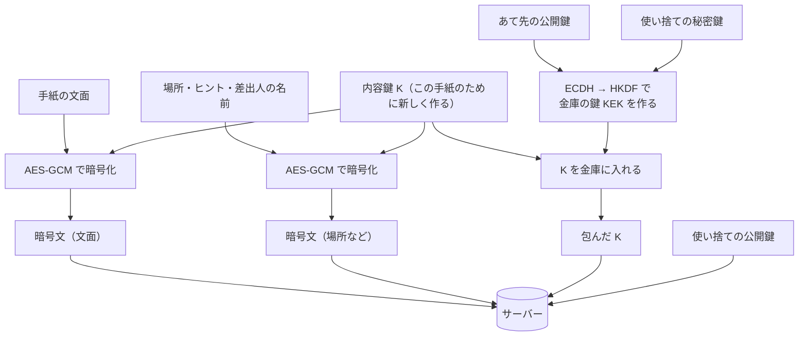

# アルクカナとは？

その場所に着いたときだけ開ける手紙を、だれか1人あてに埋めておけるWebアプリです。

例えば、母が一人暮らしの子の最寄り駅の改札に「おつかれさま」を埋めておく。子が改札を出たら、その手紙を開けられます。

- 公開 URL：https://arukukana.vercel.app/
- 全国IT専門学校プログラミングコンテスト 提出作品（テーマ「1ミリ良くする」）

ちなみに名前の由来はラテン語で秘密を表す「アルカナ」と日本語の「歩く」を掛けました。

## 試し方（その場所に行かなくても試せます）

ログインは要りません。開くとそのまま使えます。はじめは「デモモード」で、地図の中心は東京駅です。

1. はじめの画面で「位置なしで試す」を押すと、足元に「ようこそ」の手紙が 1 通埋まる
2. 「地図」タブに、手紙の場所が金色の円で出る。カードの「手紙を見る」→「封を切る」で文面が出る
3. 手紙の下の「しくみを見る」で、同じ手紙が運営（サーバー）からどう見えるかを見比べられる
4. 「埋める」タブで、自分あてに手紙を 1 通書いて「封をして埋める」
5. 地図をタップすると、その場所が現在地になる（離れると円が点線になり、カードに残りの距離が出る）
6. カードの「デモ：ここまで歩いたことにする」で、その手紙の場所まで移動できる

友だちに送るときは、「友だち」タブの QR かリンクを相手に開いてもらいます。相手が追加すると、相手の「埋める」のあて先にあなたが出ます。

実際に歩いて試すときは、地図の「現在地を使う」を押して位置情報を許可します。

## こだわり：運営にも読めない手紙

手紙はブラウザの中で暗号化してから送ります。サーバーに置かれるのは暗号文だけで、運営には文面も場所も見えません。

| 画面での言い方 | 中でやっていること |
|---|---|
| 封をする | 暗号化 |
| 封を切る | 復号 |
| 鍵の合言葉 | 公開鍵の指紋（ひらがな 4 語） |

### 暗号化の仕組み

#### たとえると

1. 手紙を**箱**に入れて、その手紙のためだけに作った**鍵**で閉める
2. その鍵を、**相手しか開けられない小さな金庫**に入れる（自分が読み返すための金庫も、もう 1 つ作る）
3. 箱と金庫をまとめてサーバーに預ける

サーバーは箱と金庫を預かるだけで、どちらも開けられません。金庫を開けられるのは、端末の中に秘密鍵を持っている本人だけです。

#### 登場する鍵

| 鍵 | たとえ | だれが持つ | どこにあるか |
|---|---|---|---|
| 端末の鍵ペア（公開鍵と秘密鍵） | 金庫の「投入口」と「開ける鍵」 | 1 人に 1 組 | 秘密鍵は端末の中だけ。公開鍵はサーバーで公開 |
| 内容鍵 K | 箱の鍵 | 手紙 1 通に 1 つ | 金庫に入った状態でサーバーに置く |
| 使い捨ての鍵ペア | その金庫 1 つを閉めるためだけの道具 | 金庫 1 つに 1 組 | 秘密鍵はすぐ捨てる。公開鍵は金庫に添える |
| 鍵を包む鍵 KEK | 金庫そのものの鍵 | 金庫 1 つに 1 つ | どこにも保存しない。毎回、計算で作る |

公開鍵は「見られてよい鍵」、秘密鍵は「本人だけが持つ鍵」です。公開鍵で閉めたものは、対になる秘密鍵でしか開けられません。

#### 封をする（差出人の端末の中で）



1. **箱を閉める**：手紙ごとにランダムな内容鍵 K（AES-GCM 256bit）を作り、「文面」と「場所・ヒント・差出人の名前」を別々に暗号化する
2. **金庫の鍵を作る**：使い捨ての鍵ペアを作り、その秘密鍵と**相手の公開鍵**を組み合わせる（ECDH P-256）。出てきた値を HKDF-SHA256 に通して、金庫の鍵 KEK にする
3. **K を金庫に入れる**：KEK で K を暗号化する（AES-GCM）
4. **自分のぶんも作る**：2〜3 を、自分の公開鍵でもう一度行う。差出人が読み返せるようにするため
5. **預ける**：暗号文、包んだ K、使い捨ての公開鍵をサーバーに送る。使い捨ての秘密鍵と KEK は捨てる

#### 封を切る（あて先の端末の中で）

1. サーバーから、暗号文・包んだ K・使い捨ての公開鍵を受け取る
2. **自分の秘密鍵**と使い捨ての公開鍵を組み合わせる（ECDH）。封をしたときと同じ値が出てくるので、同じ手順で KEK が作れる
3. KEK で金庫を開けて K を取り出し、K で文面を元に戻す

ECDH は「自分の秘密鍵 × 相手の公開鍵」と「相手の秘密鍵 × 自分の公開鍵」が同じ値になる、というしくみです。秘密鍵そのものを送らなくても、2 人だけが同じ値にたどり着けます。

#### なぜ 2 段階にするのか（ハイブリッド暗号）

公開鍵のしくみだけでは長い文章を扱いにくく、共通の鍵（AES）だけでは、その鍵を相手に安全に渡す方法がありません。そこで「本文は AES で暗号化し、AES の鍵だけを公開鍵のしくみで渡す」という組み合わせにしています。HTTPS やメッセージアプリでも使われている、標準的なやり方です。

#### 書き換えへの備え

| されること | どうなるか | しくみ |
|---|---|---|
| 暗号文を 1 文字でも変える | 開けられない | AES-GCM が改ざんを検知する |
| あて先・差出人を書き換える | 開けられない | 暗号化のとき、あて先・差出人・手紙の ID を「付帯データ（AAD）」として結びつけている |
| 文面と場所の暗号文を入れ替える | 開けられない | AAD に「これは文面」「これは場所」の区別も入れている |
| 包んだ K を別の手紙・別の人に付け替える | 開けられない | KEK を作るとき、手紙の ID と相手の ID を材料に入れている |
| 他人が自分の秘密鍵で開けようとする | 開けられない | ECDH で出てくる値が違うので、KEK が作れない |

これらはすべて [src/lib/crypto.test.ts](src/lib/crypto.test.ts) のテストで確かめています。

#### 鍵の合言葉

相手の公開鍵が本物かどうかを確かめるための 4 語です。公開鍵を SHA-256 にかけ、先頭 4 バイトを、ひらがな 256 語のリストで 1 バイト 1 語に置き換えます。同じ公開鍵からは必ず同じ 4 語になるので、相手の画面と読み合わせれば、鍵の取り違えに気づけます。

#### 実装で守っていること

- 暗号はブラウザ標準の Web Crypto API だけで組んでいます（暗号ライブラリなし、独自の方式なし）
- 秘密鍵は「取り出せない鍵」として端末に保存します。JavaScript からも中身を読めず、サーバーにも送りません
- 手紙の文面や座標を、ログやサーバーに平文で出しません

### サーバーに置くもの

| 置くもの | 中身 |
|---|---|
| `users/{uid}` | 公開鍵と作成日時だけ |
| `capsules/{id}` | あて先と差出人の uid、作成日時、暗号文（場所・ヒント／文面）、包んだ鍵 |

「開けたかどうか」はサーバーに送らず、端末の中にだけ覚えます。開けた文面は、端末にも保存しません。

読み書きの条件は [firestore.rules](firestore.rules) に書いています。

- 手紙を読めるのは、あて先と差出人だけ
- 作れるのは、自分を差出人にした手紙だけ。形と長さが決まったとおりでないと弾く
- 一度埋めた手紙は書き換えられない。消せるのは差出人だけ

### 注意点！

- 「その場所に着いたか」「開けられる日を過ぎたか」は端末側の判定です。暗号そのものが場所に結びついているわけではありません
- 一度封を切った手紙は、その端末ではどこからでも読み返せます
- 秘密鍵はその端末にしかないので、機種変更やブラウザのデータ削除で手紙は読めなくなります

## いまの状態

開発中です（締切 2026-11-13）。

- [x] 土台（画面の骨組み、匿名サインイン）
- [x] 暗号モジュールとテスト
- [x] 地図・現在地・埋める・届いた一覧・封を切る
- [x] デモモード（地図をタップして移動、「ここまで歩いたことにする」）
- [x] 友だちに送る（鍵の交換・共有リンク・QR）
- [x] はじめて画面と「ようこそ」の手紙
- [x] 運営から見えるもの（サーバー上の暗号文と、端末で開いた結果を見比べる画面）
- [x] 封を切るアニメーション、ホーム画面への追加（PWA）
- [ ] スマホ実機と PC での通し確認、文言の調整

## 技術スタック

| 用途 | 採用 |
|---|---|
| ビルド / UI | Vite + React + TypeScript（strict）、react-router |
| スタイル | Tailwind CSS v4 |
| 認証 | Firebase Authentication（匿名。登録画面なし） |
| DB | Cloud Firestore（暗号文のみ保存） |
| 地図 | MapLibre GL JS + OpenFreeMap（色を夜トーンに上書き） |
| 位置 | Geolocation API。距離はハーバサイン式で自前計算 |
| 暗号 | Web Crypto API |
| 鍵の保存 | IndexedDB（idb-keyval） |
| QR 表示 | qrcode（読み取りはスマホ標準のカメラ） |
| アニメーション | motion（封を切る演出だけ） |
| PWA | vite-plugin-pwa（ホーム画面に追加できる。端末に置くのはアプリ本体だけ） |
| テスト / CI | Vitest、GitHub Actions（lint・テスト・ビルド） |
| ホスティング | Vercel |

## 動かし方

Node.js 24 で確認しています。

```bash
npm install
cp .env.example .env.local
```

`.env.local` に、Firebase コンソールの「プロジェクトの設定 → マイアプリ」に出る Web アプリの設定値を入れます。

Firebase 側では、次の 3 つを済ませておきます。

1. Authentication の「匿名」を有効にする
2. Firestore Database を「本番モード」で作る
3. Firestore の「ルール」に [firestore.rules](firestore.rules) の中身を貼って公開する

```bash
npm run dev
```

| コマンド | 内容 |
|---|---|
| `npm run dev` | 開発サーバーを起動 |
| `npm test` | テストを 1 回実行 |
| `npm run test:watch` | 変更を監視してテスト |
| `npm run build` | 型チェックと本番ビルド |
| `npm run preview` | ビルドしたものを手元で開く（PWA の確認はこちら） |
| `npm run lint` | lint |

## ディレクトリ構成

```
src/
  lib/
    crypto.ts     鍵生成・封をする・封を切る・合言葉
    words.ts      合言葉に使うひらがな 256 語
    geo.ts        距離計算・到着判定・封を切れるかの判定
    keystore.ts   端末の鍵を IndexedDB に保存
    firebase.ts   Firebase の初期化と匿名サインイン
    users.ts      公開鍵の登録と取得
    capsules.ts   手紙を埋める・自分あての手紙を見張る
    opened.ts     開封済みの記録（端末の中だけ）
    friends.ts    友だちの一覧（端末の中だけ）
  features/
    auth/         起動時の準備（サインイン・鍵・公開鍵の登録）
    welcome/      はじめて画面と「ようこそ」の手紙
    location/     現在地（GPS とデモモードの切り替え）
    map/          地図・手紙の円・いちばん近い手紙カード
    bury/         埋める画面
    letter/       届いた一覧・封筒・封を切る・紙面
    server-view/  運営から見えるもの（しくみ）
    friends/      鍵の合言葉・QR・共有リンク・友だちの追加と一覧
  components/     タブバー、想定外のエラーの画面などの共通部品
public/           アイコン
firestore.rules   Firestore のセキュリティルール
```

## テストで確かめていること

- 封をして開けると、文面が元どおりになる
- 第三者の鍵では開けられない
- あて先・差出人を書き換えると開けられない
- 場所・ヒントと文面の暗号文を入れ替えると開けられない
- サーバーに置く形に、平文の文面・ヒント・座標が含まれない
- 同じ公開鍵からは、常に同じ合言葉 4 語になる
- 保存する値の長さが、セキュリティルールの数字と合っている
- 着いていない・開けられる日より前は、封を切れない
- GPS の誤差として認めるのは 30m まで
